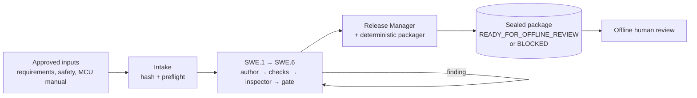

# Forge-C

**An open-source, on-premise "software dark factory" for safety-related embedded C drivers.**

You give Forge-C an approved set of inputs, such as requirements, safety inputs and the MCU reference manual. Forge-C then
runs the Automotive SPICE SWE.1–SWE.6 process with AI agents and returns a sealed, hash-verified package for a human to
review offline. AI agents write and inspect the work. Deterministic open-source tools decide whether it passes:
compilers, static analysis, MISRA checks, unit tests, coverage and footprint measurement.

> **Status: pilot.** The factory runs end to end on a local model. It is not a certified tool chain. A package is
> input to human engineering and safety review. It is **never** an ISO 26262 / ASIL B approval, an ASPICE assessment
> or a production release.

---

## How it works



1. **Intake.** The inputs are hashed into an isolated git workspace. If an agent or tool permission is missing, the
   run stops at once with a `BLOCKED` package.
2. **SWE.1 to SWE.6.** In each step an *author* agent writes the workproduct and deterministic checks run on it. A
   separate *inspector* agent then reviews it against a versioned checklist, and a gate decides. Failures go back to
   the author, with a bounded number of attempts.
3. **Release.** A Release Manager agent collects the evidence. A deterministic packager seals a hash-checked archive
   that lists every gap it found.

Several controls run alongside the workflow:

- **20 agent roles.** Each role loads a versioned `SKILL.md` and may use only its own tools, through 9 MCP tool servers
  behind a fail-closed policy hook.
- **A supervisor with no AI.** It watches the services every 60 s, dispatches bounded and reversible repairs, and seals
  a package for any run that ends without one.
- **Lessons learned.** A lesson from a verified repair is shared with later runs only after it has been validated.
- **Traces and KPIs.** Configurable traces, an audit trail and 20 manufacturing KPIs are shown on a read-only dashboard.
  Prompts, responses and model reasoning are not stored by default.

The full architecture is described in [`docs/DARK-FACTORY-ARCHITECTURE-v0.4.md`](docs/DARK-FACTORY-ARCHITECTURE-v0.4.md).
The diagrams can be edited in [`architecture/`](architecture/).

## What you need

| | |
|---|---|
| OS | Ubuntu 22.04 LTS (the validated toolchain baseline) |
| Model | Any OpenAI-compatible endpoint with tool calling: local Ollama (default `qwen3:8b`) or a vLLM server |
| Orchestrator | Fabro 0.362 (workflow engine) |
| Toolchain | Python 3.13 + [`uv`](https://github.com/astral-sh/uv), LLVM/Clang 19.1.7, `gcc-arm-none-eabi` 10.3, Cppcheck 2.7, CMake, Ninja, gcovr |

Everything is open source. Forge-C needs no paid service or cloud API at runtime. The pinned versions are listed in
[`docs/TOOLCHAIN.md`](docs/TOOLCHAIN.md) and [`docs/OSS-SETUP.md`](docs/OSS-SETUP.md).

## Quick start

```bash
# 0. Choose where data, models, state and archives live (default: see scripts/forge-env.sh)
export FORGE_DATA_ROOT=/srv/forge-c

# 1. Load the environment. Do this in every new shell.
. scripts/forge-env.sh

# 2. Install the Python factory from the hash-pinned lock file
make factory-bootstrap

# 3. Start the model server, the LLM gateway and Fabro
./scripts/forge_services.sh start          # Ollama :11435 -> gateway :11436 -> Fabro :32290
./scripts/install_supervisor.sh            # model-free supervisor as a systemd user service

# 4. Run a work order (the STM32N6 RCC driver pilot)
python -m forge_factory.workorder --example examples/0002-arm_55_rcc_st --wo WO-0002-demo --detach

# 5. Watch it
python -m forge_factory.fabro.progress <run-id>
python -m forge_factory.dashboard.app      # read-only dashboard on http://127.0.0.1:8765
```

Fabro reads its model provider settings from `$FORGE_FABRO_CONFIG`. See
[`config/fabro-settings.oss.example.toml`](config/fabro-settings.oss.example.toml) for the provider and model entries.

## Reading the result

Existing-code work orders can [resume from validated accepted phases](docs/VALIDATED-BROWNFIELD-RESUME.md)
using `--resume-from <terminal-work-order>`. Resume preserves delivery provenance and shares finite attempt/time
budgets across the lineage; incompatible or unversioned sources are refused.

[Local autonomous recovery](docs/afo/LOCAL-SELF-HEALING.md) runs through the signed AFO Conductor:
bounded diagnosis, validated author rework and isolated factory repair proposals.

A finished work order leaves a write-once archive in `$FORGE_ARCHIVE_DIR`, with one of two statuses:

- **`READY_FOR_OFFLINE_REVIEW`**: every gate passed. The package is ready for human review. This is still **not** an
  approval.
- **`BLOCKED`**: something is missing or failed. `missing_artifacts.json` and `REVIEW_SUMMARY.md` say exactly what.

To verify an archive and then review it:

```bash
python -c "from pathlib import Path; from forge_factory.release.finalize import verify_archive; \
print(verify_archive(Path('<archive.zip>')))"
```

Then read `REVIEW_SUMMARY.md`, `evidence/quality/final-gates.json` and `evidence/safety/known_limitations.md`.

## Everyday commands

| Task | Command |
|---|---|
| Service status | `./scripts/forge_services.sh status` |
| Stop services | `./scripts/forge_services.sh stop` |
| Supervisor status | `systemctl --user status forge-supervisor` |
| Factory test suite | `make factory-test` |
| Design and registry check | `make design-check` |
| Baseline tests (v0.1 demo) | `make test` |
| v0.3 reference packager tests | `python3 -m unittest discover -s factory/release-manager/tests -p 'test_*.py'` |
| Implementation status report | `make status` |
| Compute KPI snapshot | `make kpi` |

Backup, recovery, trace retention and the failure runbook are in [`docs/OPERATIONS-v0.4.md`](docs/OPERATIONS-v0.4.md).

## Repository map

| Path | What is there |
|---|---|
| [`factory/python/forge_factory/`](factory/python/forge_factory/) | The factory: workflow generator, LLM gateway, MCP servers, supervisor, repair, lessons, events, dashboard, KPIs, release packager |
| [`.fabro/skills/`](.fabro/skills/) | The versioned `SKILL.md` for each of the 20 agent roles |
| [`config/factory/`](config/factory/) | Agent permissions, MCP registry, supervisor, trace, token and KPI policies |
| [`examples/`](examples/) | Work order inputs (generic RCC, STM32N6 RCC) |
| [`specs/`](specs/) | Spec Kit features: 001 OSS driver bootstrap, 002 self-healing factory, 003 manufacturing KPIs |
| [`docs/`](docs/) | Architecture, operations, compliance matrix, ADRs ([`docs/adr/`](docs/adr/)) |
| [`drivers/`](drivers/), [`tests/`](tests/) | v0.1 RCC host demonstrator and baseline tests |
| [`evidence/`](evidence/) | Recorded test and run evidence |

## Current status

- All 51 tasks of the self-healing factory (002) and all 20 KPI tasks (003) pass, each with recorded test evidence.
  The task-by-task report is [`docs/IMPLEMENTATION-STATUS-v0.4.md`](docs/IMPLEMENTATION-STATUS-v0.4.md).
- On the STM32N6 RCC pilot, SWE.1 to SWE.6 have all passed in a single run. Packages still end `BLOCKED`, because
  target verification (simulator or hardware), full MISRA coverage and the deferred safety documents are missing. The
  package declares each of these gaps.
- Known findings from running local models are recorded in
  [`docs/adr/ADR-0005-local-model-runtime-findings.md`](docs/adr/ADR-0005-local-model-runtime-findings.md).

## Safety and limitations

- MISRA C coverage is the Cppcheck addon subset only, and no compliance is claimed.
- Coverage, tests and footprint figures are host-level evidence, not linked target firmware.
- No tool, including Forge-C itself, is qualified under ISO 26262-8.
- Every safety decision requires competent offline human review.

## For contributors

Forge-C is implemented with Claude Code as the engineering assistant. Claude Code is not part of the production
runtime. To work on the factory, start with [`CLAUDE.md`](CLAUDE.md), [`CLAUDE_START.md`](CLAUDE_START.md) and
[`PROJECT_HANDOFF_v0.5.md`](PROJECT_HANDOFF_v0.5.md).
On the on-premise VM, the local Qwen Code assistant follows [`QWEN.md`](QWEN.md), which carries the same rules.

## Licence

[Apache-2.0](LICENSE).
