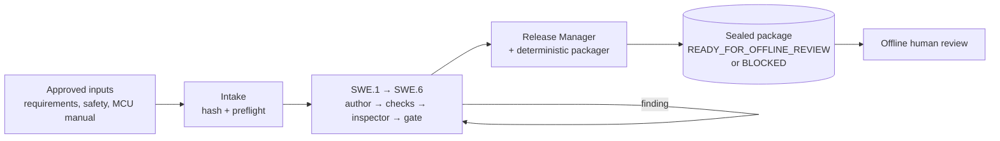

# Forge-C

[**Public website & documentation**](https://jnsagai.github.io/forge-c/)

**An open-source, on-premise "software dark factory" for safety-related embedded C drivers.**

You give Forge-C an approved set of inputs, such as requirements, safety inputs and the MCU reference manual. Forge-C then
runs the Automotive SPICE SWE.1–SWE.6 process with AI agents and returns a sealed, hash-verified package for a human to
review offline. AI agents write and inspect the work. Deterministic open-source tools decide whether it passes:
compilers, static analysis, MISRA checks, unit tests, coverage and footprint measurement.

> **Status: pilot.** The factory runs end to end on a local model. It is not a certified tool chain. A package is
> input to human engineering and safety review. It is **never** an ISO 26262 / ASIL B approval, an ASPICE assessment
> or a production release.

**Is Forge-C for you?** It is for embedded and functional-safety engineers who want to see how far an AI-driven,
evidence-first process can take a low-level driver (for example an STM32 RCC or IWDG driver), entirely on their own
machine and with open-source tools. It is not a code generator you can drop into a product as is.

---

## Key terms

| Term | Meaning |
|---|---|
| **Work order** | One job for the factory: a driver to build, its inputs (requirements, reference-manual sections, budgets) and its scope. The examples in [`examples/`](examples/) are work orders. |
| **SWE.1 … SWE.6** | The six Automotive SPICE software engineering steps: requirements, architecture, detailed design and code, unit verification, integration verification, qualification testing. |
| **Author / inspector** | Two separate AI agents per step. The author writes the work product; the inspector reviews it against a versioned checklist. |
| **Gate** | The deterministic decision after each step: pass, send back to the author with the findings, or stop. |
| **Package** | The sealed archive a finished work order leaves for human review: `READY_FOR_OFFLINE_REVIEW` or `BLOCKED`. |
| **Fabro** | The workflow engine that runs the steps. **MCP** servers are the only tools an agent may use. |

## How it works



1. **Intake.** The inputs are hashed into an isolated git workspace. If an agent or tool permission is missing, the
   run stops at once with a `BLOCKED` package.
2. **SWE.1 to SWE.6.** In each step an *author* agent writes the workproduct and deterministic checks run on it. A
   separate *inspector* agent then reviews it against a versioned checklist, and a gate decides. Failures go back to
   the author, with a bounded number of attempts.
3. **Release.** A Release Manager agent collects the evidence. A deterministic packager seals a hash-checked archive
   that lists every gap it found.

Several controls run alongside the workflow:

- **20 agent roles.** Each role loads a versioned `SKILL.md` and may use only its own tools, through 9 MCP tool servers
  behind a fail-closed policy hook.
- **A supervisor with no AI.** It watches the services every 60 s, dispatches bounded and reversible repairs, and seals
  a package for any run that ends without one.
- **Lessons learned.** A lesson from a verified repair is shared with later runs only after it has been validated.
- **Traces and KPIs.** Configurable traces, an audit trail and 20 manufacturing KPIs are shown on a read-only dashboard.
  Prompts, responses and model reasoning are not stored by default.

The full architecture is described in [`docs/DARK-FACTORY-ARCHITECTURE-v0.4.md`](docs/DARK-FACTORY-ARCHITECTURE-v0.4.md).
The diagrams can be edited in [`architecture/`](architecture/).

## What you need

| | |
|---|---|
| OS | Ubuntu 22.04 LTS (the validated toolchain baseline) |
| Model | Any OpenAI-compatible endpoint with tool calling: local Ollama (default `qwen3:8b`) or a vLLM server |
| Orchestrator | Fabro 0.362 (workflow engine) |
| Toolchain | Python 3.13 + [`uv`](https://github.com/astral-sh/uv), LLVM/Clang 19.1.7, `gcc-arm-none-eabi` 10.3, Cppcheck 2.7, CMake, Ninja, gcovr |
| Hardware | A GPU is optional but strongly recommended; on CPU only, a full work order takes many hours |

Everything is open source. Forge-C needs no paid service or cloud API at runtime. The pinned versions are listed in
[`docs/TOOLCHAIN.md`](docs/TOOLCHAIN.md); a step-by-step installation is in [`docs/OSS-SETUP.md`](docs/OSS-SETUP.md).

## Try it first (no model needed)

These checks run in a minute or two and confirm that the repository and your Python are in order before you set up
a model and Fabro:

```bash
git clone https://github.com/jnsagai/forge-c.git && cd forge-c
make test           # baseline tests of the v0.1 RCC host demonstrator
make design-check   # checks the design files, schemas and the agent/tool registry
```

## Quick start (a full work order)

```bash
# 0. Choose where data, models, state and archives live. Set this BEFORE anything else:
#    the default in scripts/forge-env.sh is a developer's path and will not exist on your machine.
export FORGE_DATA_ROOT=/srv/forge-c        # any directory you own, with room for models, state and archives

# 1. Load the environment. Do this in every new shell.
. scripts/forge-env.sh

# 2. Install the Python factory from the hash-pinned lock file
make factory-bootstrap

# 3. Start the model server, the LLM gateway and Fabro, then the supervisor
./scripts/forge_services.sh start          # Ollama :11435 -> gateway :11436 -> Fabro :32290
./scripts/forge_services.sh status         # all three should report healthy
./scripts/install_supervisor.sh            # model-free supervisor as a systemd user service

# 4. Run a work order (the STM32N6 RCC driver pilot). It prints a run id.
python -m forge_factory.workorder --example examples/0002-arm_55_rcc_st --wo WO-0002-demo --detach

# 5. Watch it
python -m forge_factory.fabro.progress <run-id>
python -m forge_factory.dashboard.app      # read-only dashboard on http://127.0.0.1:8765
```

The model must be available to the Ollama instance the services start, for example
`OLLAMA_HOST=127.0.0.1:11435 ollama pull qwen3:8b`. Fabro reads its model provider settings from
`$FORGE_FABRO_CONFIG`; see [`config/fabro-settings.oss.example.toml`](config/fabro-settings.oss.example.toml) for the
provider and model entries. A work order runs for hours, not minutes: each step is authored, checked and inspected,
and failures go back to the author.

## Reading the result

A finished work order leaves a write-once archive in `$FORGE_ARCHIVE_DIR`, with one of two statuses:

- **`READY_FOR_OFFLINE_REVIEW`**: every gate passed. The package is ready for human review. This is still **not** an
  approval.
- **`BLOCKED`**: something is missing or failed. `missing_artifacts.json` and `REVIEW_SUMMARY.md` say exactly what.

To verify an archive and then review it:

```bash
python -c "from pathlib import Path; from forge_factory.release.finalize import verify_archive; \
print(verify_archive(Path('<archive.zip>')))"
```

Then read, in this order: `REVIEW_SUMMARY.md` (what was built and what is missing),
`evidence/quality/final-gates.json` (every gate decision) and `evidence/safety/known_limitations.md`.

## Troubleshooting

| Symptom | What to check |
|---|---|
| A script complains about a missing directory or file under a strange path | `FORGE_DATA_ROOT` is not set in this shell. Export it and run `. scripts/forge-env.sh` again. |
| `forge_services.sh status` shows a service down | Run `./scripts/forge_services.sh stop` then `start`; check that ports 11435, 11436 and 32290 are free. |
| The run stops at once with `BLOCKED` | Read `REVIEW_SUMMARY.md` in the package: intake stops early when an input, a tool or a permission is missing. |
| A step goes back to the author several times | This is the normal rework loop; the number of attempts is bounded. The findings are in the work order's `inspection/` folder. |
| Very slow progress | The model runs on CPU or a small GPU. Check the speed on the dashboard; see [`docs/OPTIMIZATION.md`](docs/OPTIMIZATION.md). |

The failure runbook, backup, recovery and trace retention are in [`docs/OPERATIONS-v0.4.md`](docs/OPERATIONS-v0.4.md).

## Everyday commands

| Task | Command |
|---|---|
| Service status | `./scripts/forge_services.sh status` |
| Stop services | `./scripts/forge_services.sh stop` |
| Supervisor status | `systemctl --user status forge-supervisor` |
| Factory test suite | `make factory-test` |
| Design and registry check | `make design-check` |
| Baseline tests (v0.1 demo) | `make test` |
| v0.3 reference packager tests | `python3 -m unittest discover -s factory/release-manager/tests -p 'test_*.py'` |
| Implementation status report | `make status` |
| Compute KPI snapshot | `make kpi` |

## Repository map

| Path | What is there |
|---|---|
| [`factory/python/forge_factory/`](factory/python/forge_factory/) | The factory: workflow generator, LLM gateway, MCP servers, supervisor, repair, lessons, events, dashboard, KPIs, release packager |
| [`.fabro/skills/`](.fabro/skills/) | The versioned `SKILL.md` for each of the 20 agent roles |
| [`config/factory/`](config/factory/) | Agent permissions, MCP registry, supervisor, trace, token and KPI policies |
| [`examples/`](examples/) | Work orders: generic RCC, STM32N6 RCC low-level (LL) and HAL drivers, RCC drivers built on delivered code, IWDG LL and HAL |
| [`specs/`](specs/) | Spec Kit features: 001 OSS driver bootstrap, 002 self-healing factory, 003 manufacturing KPIs |
| [`docs/`](docs/) | Architecture, operations, compliance matrix, ADRs ([`docs/adr/`](docs/adr/)) |
| [`drivers/`](drivers/), [`tests/`](tests/) | v0.1 RCC host demonstrator and baseline tests |
| [`evidence/`](evidence/) | Recorded test and run evidence |

## Where to read next

| If you want to … | Read |
|---|---|
| Install everything step by step | [`docs/OSS-SETUP.md`](docs/OSS-SETUP.md) |
| Understand the design | [`docs/DARK-FACTORY-ARCHITECTURE-v0.4.md`](docs/DARK-FACTORY-ARCHITECTURE-v0.4.md) |
| See the STM32N6 RCC pilot in detail | [`docs/PILOT-STM32N6-RCC.md`](docs/PILOT-STM32N6-RCC.md) |
| Run work orders on code you already have | [`docs/BROWNFIELD-WORK-ORDERS.md`](docs/BROWNFIELD-WORK-ORDERS.md) |
| Know what the checklists check | [`docs/SWE-CHECKLISTS.md`](docs/SWE-CHECKLISTS.md) |
| Operate the factory day to day | [`docs/OPERATIONS-v0.4.md`](docs/OPERATIONS-v0.4.md) |

## Current status

- All 51 tasks of the self-healing factory (002) and all 20 KPI tasks (003) pass, each with recorded test evidence.
  The task-by-task report is [`docs/IMPLEMENTATION-STATUS-v0.4.md`](docs/IMPLEMENTATION-STATUS-v0.4.md).
- In the rc1 regression round, every example work order (RCC LL and HAL, RCC on delivered code, IWDG LL and HAL)
  reached a `READY_FOR_OFFLINE_REVIEW` package with 0 gaps; see
  [`evidence/v0.4/runs/RC1/README.md`](evidence/v0.4/runs/RC1/README.md). That round used cloud models as author and
  inspector; runs on local models are ongoing.
- Known findings from running local models are recorded in
  [`docs/adr/ADR-0005-local-model-runtime-findings.md`](docs/adr/ADR-0005-local-model-runtime-findings.md).

## Safety and limitations

- MISRA C coverage is the Cppcheck addon subset only, and no compliance is claimed.
- Coverage, tests and footprint figures are host-level evidence, not linked target firmware.
- No tool, including Forge-C itself, is qualified under ISO 26262-8.
- Every safety decision requires competent offline human review.

## For contributors

Forge-C is implemented with Claude Code as the engineering assistant. Claude Code is not part of the production
runtime. To work on the factory, start with [`CLAUDE.md`](CLAUDE.md), [`CLAUDE_START.md`](CLAUDE_START.md) and
[`PROJECT_HANDOFF_v0.5.md`](PROJECT_HANDOFF_v0.5.md).
On the on-premise VM, the local Qwen Code assistant follows [`QWEN.md`](QWEN.md), which carries the same rules.

## Licence

[Apache-2.0](LICENSE).
