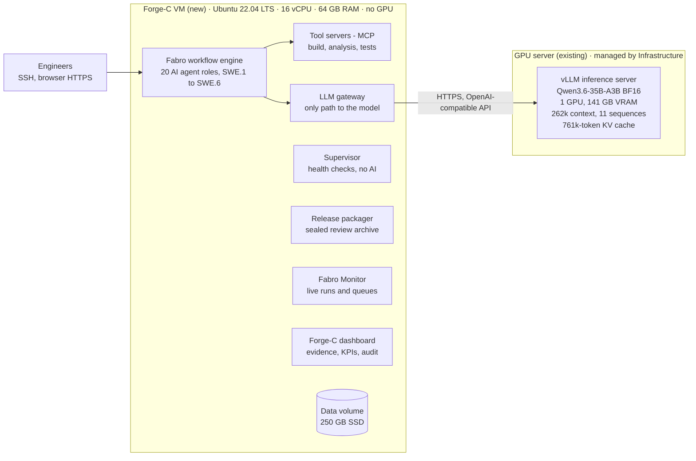

# Forge-C On-Premise Deployment — System, Architecture & Infrastructure Requirements

Status: draft for the Infrastructure team · 2026-10-15 · reviewed 2026-10-21: minimal (Capgemini setup) column added,
software list corrected (see [Review notes](#review-notes-2026-10-21))

## Executive summary

Forge-C needs one new Ubuntu VM with no GPU. All AI inference runs on the existing GPU server, a separate machine that Forge-C calls over the internal network.

- **What Forge-C is:** an on-premise "software dark factory". AI agents draft and inspect embedded C workproducts for ASPICE SWE.1–SWE.6. Open-source tools (compilers, static analysis, tests) decide pass or fail.
- **New VM (request):** Ubuntu 22.04 LTS, 16 vCPU, 64 GB RAM and a 250 GB SSD data volume. It runs all Forge-C software.
- **GPU server (existing, unchanged):** vLLM serving Qwen3.6-35B-A3B. No Forge-C software is installed on it.
- **Fit:** an agent call peaks at about 40k tokens. The 761,376-token KV cache holds 7 factory agents at 64k context plus a coding assistant at 2 × 128k.
- **Security:** Forge-C handles customer IP that may be export-controlled. Both machines, all backups and all access must stay inside Capgemini's controlled zone, with no internet access at runtime.

## What Forge-C does

One command turns an approved input baseline into a sealed package for offline human review. The baseline holds the requirements, safety inputs and the MCU reference manual.

1. **Intake:** the inputs are hashed into an isolated workspace, and the agent permissions are checked.
2. **SWE.1 to SWE.6:** for each step, an author agent writes, a separate inspector agent reviews, and deterministic gates decide. Failures loop back for a bounded number of reworks.
3. **Verification:** open-source tools compile, analyse and test the C code for the host and for Arm Cortex-M.
4. **Release:** a hash-sealed archive is produced, marked `READY_FOR_OFFLINE_REVIEW` or `BLOCKED`.

A package is input to human review only. It is not ISO 26262 or ASPICE approval, nor a production release. Forge-C is at pilot stage: all 71 implementation tasks pass their tests, and a full SWE.1–SWE.6 run has passed on the STM32N6 clock-driver pilot.

## Architecture

Forge-C runs on two separate machines. The new VM runs all Forge-C software on CPU only. The existing GPU server only answers model requests.

The only link between the two machines is the LLM gateway on the VM, which calls the GPU server's OpenAI-compatible API over HTTPS. The agents reach compilers and analysers only through the tool servers, which check each role's permissions. The supervisor makes no AI calls; it restarts failed services and makes sure every run ends with a sealed package.

Two read-only web dashboards also run on the VM. **Fabro Monitor** (port 8787) shows live runs, workflow graphs, agent logs and work-order queues. The **Forge-C dashboard** (port 8765) shows evidence, KPIs, incidents and the audit trail. Both are reached through an HTTPS reverse proxy on the VM.

## How Forge-C uses the GPU server

The current GPU server configuration is sufficient and needs no change. Forge-C uses non-thinking mode with automatic tool calling, and does not use vision.

| Measure (one full work order) | Value |
| --- | --- |
| Prompt per agent call: median / peak | 13,910 / 39,524 tokens |
| Context limit per agent (Forge-C setting) | 65,536 tokens |
| Model calls / generated tokens | 520–600 calls / about 170k tokens |
| Duration | 41–48 min |

What Forge-C needs from the GPU server:

| GPU server item | Recommended | Minimal (Capgemini setup) |
| --- | --- | --- |
| Factory work orders in parallel | Up to 7 agent sequences (several work orders) | 1 work order at a time: 1 sequence |
| Context per factory sequence | 65,536 tokens | 65,536 tokens (peak prompt 39,524 + up to 16,384 output tokens) |
| KV cache used by Forge-C | 720,896 tokens (7 × 65,536 + assistant 2 × 131,072) | 65,536 tokens; 196,608 with one assistant session of 131,072 |
| Coding-assistant sessions | 2 × 131,072 tokens | 0 (development elsewhere) or 1 × 131,072 |
| Prefix caching | On | On (agents re-send their growing conversation on every call) |
| API features | OpenAI-compatible chat completions with tool calling, streaming, non-thinking mode | Same |

With 2 sequences reserved for the coding assistant (262,144 tokens), 7 factory agents at 65,536 tokens each still fit: 720,896 tokens in total, within the 761,376-token KV cache. Agents re-send their growing conversation on every call, so vLLM prefix caching should stay on.

These figures come from 2026-10-15 runs of the same workflow on a hosted benchmark model. Forge-C has not yet run on Qwen3.6-35B-A3B, so the pilot will confirm speed and reliability on this server.

## Recommended VM environment

The request is a single Ubuntu 22.04 LTS VM. It has no GPU, because all inference runs on the separate GPU server.

| Resource | Recommended | Minimal (Capgemini setup) |
| --- | --- | --- |
| Operating system | Ubuntu 22.04.5 LTS, the release Forge-C's toolchain was validated on | Ubuntu 22.04 LTS on x86-64 (the prebuilt LLVM and Renode binaries are x86-64) |
| CPU | 16 vCPU (up to 4 work orders in parallel) | 4 vCPU (one work order at a time) |
| Memory | 64 GB RAM | 16 GB RAM |
| OS disk | 50 GB | 30 GB |
| Data volume | 250 GB SSD, mounted at `/srv/forge-c` and backed up daily | 40 GB SSD at `/srv/forge-c`, encrypted, backed up daily |
| GPU | None on the VM (inference runs on the existing GPU server) | None |

How the minimal values were derived (measured on the development host on 2026-10-21, not yet run on a VM of this
size; the first pilot work order confirms them):

- **One work order at a time.** Fabro runs one work order at a time (`max_concurrent_runs = 1`), and its build,
  analysis and simulation steps run one after another. More vCPU and RAM only buy parallel work orders.
- **Memory.** The resident Forge-C services are small: Fabro server 25–45 MB, LLM gateway 5–30 MB, supervisor 36 MB,
  dashboard 60 MB. The tools of one step are bounded by the factory sandbox: analysers at most 4 GB of address space,
  the PlantUML renderer a 512 MB Java heap, and Renode a 1.5 GB .NET heap. 16 GB leaves room for the OS, the page
  cache and one such step. 8 GB has not been tried.
- **Data volume.** The toolchains take about 11.5 GB: LLVM 19.1.7 8.2 GB, the Frama-C opam root 2.3 GB, CBMC 0.2 GB,
  Renode 0.2 GB and cvc5 0.1 GB. The Python environment and caches take about 0.4 GB. One work order adds 5–25 MB of
  workspace and a 0.4–1.3 MB sealed archive; 212 work orders used 2.3 GB of state. 40 GB holds the toolchains and
  several hundred work orders. Without the optional formal tools, about 2.5 GB less.

### Software on the VM

All software is open source and needs no paid licence or cloud service.

| Component | Version | Licence | Minimal (Capgemini setup) |
| --- | --- | --- | --- |
| Fabro workflow engine | 0.362.0 | MIT | Required |
| Forge-C factory | Tagged release of `main` | Apache-2.0 | Required |
| Python (via `uv`) with the pinned packages of `requirements/forge-factory.lock` (incl. Robot Framework) | 3.13 | PSF-2.0 and package licences | Required; `uv` downloads the interpreter, so use an internal mirror or an offline Python build |
| LLVM / Clang (host build, coverage) | 19.1.7 prebuilt release | Apache-2.0 with LLVM exception | Required |
| GNU Arm Embedded GCC (target build, size and stack evidence) | 10.3-2021.07 (Ubuntu package `gcc-arm-none-eabi`) | GPL-3.0 with exceptions | Required |
| GCC, CMake, Ninja, Cppcheck, gcovr, git | Ubuntu 22.04 packages | GPL / BSD / Apache | Required |
| Renode (SWE.5/SWE.6 target tests; bundles its .NET runtime) | 1.17.0 portable | MIT | Required |
| OpenJDK (runs PlantUML for the SWE.2 views gate) | 11, Ubuntu package | GPL-2.0 with Classpath exception | Required |
| PlantUML | 1.2026.8 ASL jar | Apache-2.0 | Required |
| Doxygen (code documentation in the review package) | 1.9.1, Ubuntu package | GPL-2.0 | Required |
| CBMC; Frama-C with Why3, Alt-Ergo-free and cvc5 (formal assurance) | 6.11.0; 33.0, 1.8.2, 2.4.3, 1.2.1 (release binaries and an opam build, not Ubuntu packages) | BSD-4 / LGPL-2.1 / CeCILL-C / BSD-3 | Optional: the assurance checks that use them are observe-only; without them they are recorded as not run |
| Podman, rootless (sandbox of the change-promotion gate) | 3.4.4, Ubuntu package | Apache-2.0 | Optional: needed only to promote factory changes on the VM; requires subordinate UID/GID ranges for the service account |
| Fabro Monitor (dashboard) | Current, Python 3.10+ standard library only | Apache-2.0 | Optional |
| nginx (HTTPS reverse proxy) | Ubuntu 22.04 package | BSD-2-Clause | Optional: without it, engineers reach the dashboards through an SSH tunnel |
| Qwen Code CLI (coding assistant) | Pinned at install, Node.js 20 LTS | Apache-2.0 | Optional: only for development on the VM |
| Ollama | - | MIT | Not needed: inference runs on the GPU server |

### Network

| Flow | Port | When | Minimal (Capgemini setup) |
| --- | --- | --- | --- |
| VM → GPU server (OpenAI-compatible API) | GPU server's API port, HTTPS | Always | Required |
| Engineers → VM (SSH) | 22 | Always | Required |
| VM → apt and PyPI mirrors, github.com releases | 443 | Setup and upgrades only | Required at setup, or offline packages checked against pinned hashes |
| Engineers and reviewers → dashboards (reverse proxy) | 443 | Always | Optional (SSH tunnel instead) |

All Forge-C services on the VM, including both dashboards, listen on localhost only and are exposed only through the reverse proxy.

### Accounts

- A non-root service account, for example `forge`, with `sudo` during setup.
- User lingering enabled (`loginctl enable-linger forge`), so the supervisor service keeps running without a login session.
- An API credential for the GPU server.

## Development on the VM

Forge-C keeps evolving while it runs, so the VM also hosts a local AI coding assistant that uses the same GPU server. No code or data leaves the controlled zone.

| Item | Recommendation | Minimal (Capgemini setup) |
| --- | --- | --- |
| Coding assistant | Qwen Code CLI (Apache-2.0), a terminal agent like Claude Code, connected to the GPU server's OpenAI-compatible API | Optional: without it, changes are made elsewhere and arrive as tagged releases |
| Runtime | Node.js 20 LTS or later | Only with the assistant |
| GPU share | At most 2 of the 11 sequences, 131,072 tokens each (262,144 of the 761,376-token KV cache), with its own API key | 1 session of 131,072 tokens with its own API key, or none |
| Separation | Development uses its own git worktree, data root and Fabro instance. Production runs only tagged releases and cannot be touched by the assistant | Same; on the minimal VM, development and production work orders do not run at the same time |
| Source control | An internal Git server (GitLab or Bitbucket) inside the controlled zone, because the VM has no internet access | Required |
| Project rules | A `QWEN.md` in the repository carries the same engineering rules as today's Claude Code contract | Required with the assistant |
| Telemetry | Disabled in the assistant settings; the VM's lack of internet access enforces this | Same |

Assistant session history contains customer IP, so it stays on the encrypted data volume under the same retention rules. Every change is tested with the factory test suites and reviewed by an engineer before it reaches a production release.

## Security, customer IP and export control

Forge-C processes customer IP, such as requirements, designs, source code and vendor manuals, that may be subject to export control. The whole deployment must therefore stay inside Capgemini's controlled network zone, and no customer data may leave it.

### Requirements on the environment

- **One controlled zone:** the VM, the GPU server, the reverse proxy and all backups sit in the same export-controlled network zone. The GPU server receives customer IP inside every prompt, so it is in scope too.
- **No internet at runtime:** after setup, the VM needs no outbound access except to the GPU server. Setup should use internal apt and PyPI mirrors or offline packages, checked against pinned hashes.
- **Need-to-know access:** SSH and dashboard access only for named project members, through company SSO or LDAP. Forge-C isolates each work order in its own workspace, but it does not separate customers from each other on one VM. A separate VM per customer program is therefore recommended.
- **Encryption at rest:** the data volume and its backups are encrypted.
- **No prompt logging on the GPU server:** vLLM request logging must stay off. If the server is shared with other projects, its access and logs must meet the same classification.
- **Model provenance:** Qwen3.6-35B-A3B is a third-party open-weight model that runs fully offline, so no data goes back to its publisher. Its licence and origin should be approved by Capgemini security and export-control compliance.
- **Retention and deletion:** retention periods are configurable to match each customer contract, and a program's data can be deleted when it ends.

### Built-in Forge-C controls

- **No cloud or paid services:** the tool policy forbids paid APIs, proprietary analysers and closed models.
- **Logging:** prompts, responses and model reasoning are not stored by default, and secrets are redacted. The audit trail cannot be disabled.
- **Secrets:** the GPU server credential is kept in Fabro's secret vault on the VM.
- **Agent permissions:** every tool call is checked against the agent's role, and a call that fails the check is blocked. Sealed archives are write-once and hash-verified.
- **Dashboards:** both are read-only. Fabro Monitor has no login of its own, so the reverse proxy must authenticate users.
- **Licences:** all components are open source, and a CycloneDX SBOM is generated at install time.
- **No certification claim:** Forge-C output is for human review only and is not ISO 26262 or ASPICE approval.

## Rollout and open points

Once the VM is ready, the Forge-C team can install and validate it without further work from Infrastructure.

1. Infrastructure provisions the VM, the data volume, network access to the GPU server and an API credential.
2. The Forge-C team installs the factory and connects the LLM gateway to the GPU server.
3. The Forge-C team re-runs the baseline test suites on the new setup.
4. Pilot: one work order at a time, then up to 4 in parallel based on measured load.

### Review notes (2026-10-21)

- **Software list corrected.** CBMC, Frama-C and Renode are not Ubuntu 22.04 packages here. They are pinned release
  binaries and an opam build. Renode is required for target tests; the formal tools are optional. OpenJDK with
  PlantUML and Doxygen were missing, although the SWE.2 view gate and the review package need them. Podman (optional)
  was missing too.
- **Model quality on the GPU server is not established.** Forge-C has still not run on Qwen3.6-35B-A3B. Every
  READY_FOR_OFFLINE_REVIEW package so far (the seven rc1 work orders) used Codex and Claude, which cannot run inside
  the controlled zone. A local-only trial with qwen3-coder:30b on an 8 GB laptop GPU passed SWE.1 for IWDG three
  times out of three but never passed SWE.2. Feature 010 (local-only profile) is the work that addresses this. The
  minimal column states what the software needs to run; it does not predict how many work orders reach READY.
- **The GPU figures above** come from 2026-10-15 runs on a hosted model with the full-session agent prompts. Feature
  010 splits SWE.1/SWE.2 into smaller tasks of about 3k prompt tokens. That lowers the context needed per call, but the
  65,536-token setting stays until measured on the GPU server.

### Questions for Infrastructure

- [ ] Is the GPU server dedicated to Forge-C or shared? If shared, how many of the 11 sequences can Forge-C use?
- [ ] What are the GPU server's API URL, served model name and authentication method, and is an internal CA certificate needed?
- [ ] Can you confirm that vLLM prefix caching is on and that `chat_template_kwargs` is accepted per request?
- [ ] Is there an internal apt and PyPI mirror, or temporary internet access for setup?
- [ ] Which authentication should the dashboard reverse proxy use (SSO, LDAP), and who issues its TLS certificate?
- [ ] Which export-control classification and network zone apply, and is the GPU server inside that zone?
- [ ] Is a separate VM required for each customer program?
- [ ] Is there an internal Git server in the controlled zone for the Forge-C repository, and can the generic factory code be mirrored in from GitHub?
