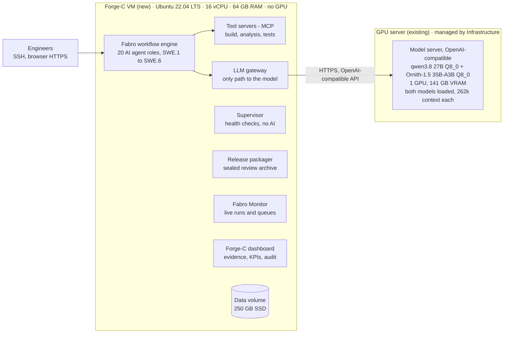

# Forge-C On-Premise Deployment — System, Architecture & Infrastructure Requirements

Status: draft for the Infrastructure team · 2026-10-15

## Executive summary

Forge-C needs one new Ubuntu VM with no GPU. All AI inference runs on the existing GPU server, a separate machine that Forge-C calls over the internal network.

- **What Forge-C is:** an on-premise "software dark factory". AI agents draft and inspect embedded C workproducts for ASPICE SWE.1–SWE.6. Open-source tools (compilers, static analysis, tests) decide pass or fail.
- **New VM (request):** Ubuntu 22.04 LTS, 16 vCPU, 64 GB RAM and a 250 GB SSD data volume. It runs all Forge-C software.
- **GPU server (existing):** an OpenAI-compatible model server that serves Forge-C's two models: `qwen3.8:27b-q8_0` (Qwen3.8 27B, GGUF Q8_0) and `Ornith-1.5-35B-A3B` (GGUF Q8_0). No Forge-C software is installed on it.
- **Fit:** both models stay loaded together at full settings (262,144-token context each): about 46 GB + 44 GB of GPU memory, measured on the Forge-C test machine, so about 90 GB of the 141 GB H200. The rest is available for more concurrent sequences or other applications.
- **Security:** Forge-C handles customer IP that may be export-controlled. Both machines, all backups and all access must stay inside Capgemini's controlled zone, with no internet access at runtime.

## What Forge-C does

One command turns an approved input baseline into a sealed package for offline human review. The baseline holds the requirements, safety inputs and the MCU reference manual.

1. **Intake:** the inputs are hashed into an isolated workspace, and the agent permissions are checked.
2. **SWE.1 to SWE.6:** for each step, an author agent writes, a separate inspector agent reviews, and deterministic gates decide. Failures loop back for a bounded number of reworks.
3. **Verification:** open-source tools compile, analyse and test the C code for the host and for Arm Cortex-M.
4. **Release:** a hash-sealed archive is produced, marked `READY_FOR_OFFLINE_REVIEW` or `BLOCKED`.

A package is input to human review only. It is not ISO 26262 or ASPICE approval, nor a production release. Forge-C is at pilot stage: all 71 implementation tasks pass their tests, and a full SWE.1–SWE.6 run has passed on the STM32N6 clock-driver pilot.

## Architecture

Forge-C runs on two separate machines. The new VM runs all Forge-C software on CPU only. The existing GPU server only answers model requests.

The only link between the two machines is the LLM gateway on the VM, which calls the GPU server's OpenAI-compatible API over HTTPS. The agents reach compilers and analysers only through the tool servers, which check each role's permissions. The supervisor makes no AI calls; it restarts failed services and makes sure every run ends with a sealed package.

Two read-only web dashboards also run on the VM. **Fabro Monitor** (port 8787) shows live runs, workflow graphs, agent logs and work-order queues. The **Forge-C dashboard** (port 8765) shows evidence, KPIs, incidents and the audit trail. Both are reached through an HTTPS reverse proxy on the VM.

## How Forge-C uses the GPU server

Authoring agents use Ornith-1.5-35B-A3B; the supervisor, monitor and inspector agents use qwen3.8 27B. Forge-C needs the GPU server to serve its two models under the names it requests: `qwen3.8:27b-q8_0` (the default model) and `hf.co/ornith-ai/Ornith-1.5-35B-A3B-GGUF:Q8_0`. Both are GGUF Q8_0 files, pinned by SHA-256 in the Forge-C recipe, and run today on the llama.cpp server with these settings: 262,144-token context, one sequence each, f16 KV cache, flash attention; qwen3.8 adds its own draft model (3 tokens) and reasoning at medium effort, Ornith runs with reasoning on. Forge-C uses automatic tool calling and does not use vision. Forge-C strips any reasoning text before it stores anything.

| Measure (one full work order) | Value |
| --- | --- |
| Prompt per agent call: median / peak | 13,910 / 39,524 tokens |
| Context limit per agent (Forge-C setting) | 65,536 tokens |
| Model calls / generated tokens | 520–600 calls / about 170k tokens |
| Duration | 41–48 min |

With 2 sequences reserved for the coding assistant (262,144 tokens), 7 factory agents at 65,536 tokens each still fit: 720,896 tokens in total, within the 761,376-token KV cache. Agents re-send their growing conversation on every call, so vLLM prefix caching should stay on.

The call figures above come from 2026-10-15 runs of the same workflow on a hosted benchmark model; the two models above are the ones Forge-C runs every day on its test machine (owner decision 2026-11-08). With 141 GB both models can stay loaded, so the server never has to swap between them; on smaller GPUs Forge-C's own model service swaps them in seconds from host RAM (`deploy/recipe/README.md`).

## Recommended VM environment

The request is a single Ubuntu 22.04 LTS VM. It has no GPU, because all inference runs on the separate GPU server.

| Resource | Recommended |
| --- | --- |
| Operating system | Ubuntu 22.04.5 LTS, the release Forge-C's toolchain was validated on |
| CPU | 16 vCPU |
| Memory | 64 GB RAM |
| OS disk | 50 GB |
| Data volume | 250 GB SSD, mounted at `/srv/forge-c` and backed up daily |
| GPU | None on the VM (inference runs on the existing GPU server) |

### Software on the VM

All software is open source and needs no paid licence or cloud service.

| Component | Version | Licence |
| --- | --- | --- |
| Fabro workflow engine | 0.362.0 | MIT |
| Forge-C factory | v0.5 | Apache-2.0 |
| Python (via `uv`) | 3.13 | PSF-2.0 |
| LLVM / Clang | 19.1.7 | Apache-2.0 with LLVM exception |
| GNU Arm Embedded GCC | 10.3-2021.07 | GPL-3.0 with exceptions |
| GCC, CMake, Ninja, Cppcheck, gcovr, git | Ubuntu 22.04 packages | GPL / BSD / Apache |
| CBMC, Frama-C, Renode | Ubuntu 22.04 packages | BSD-4 / LGPL-2.1 / MIT |
| Fabro Monitor (dashboard) | Current, Python 3.10+ standard library only | Apache-2.0 |
| nginx (HTTPS reverse proxy) | Ubuntu 22.04 package | BSD-2-Clause |
| Qwen Code CLI (coding assistant) | Pinned at install, Node.js 20 LTS | Apache-2.0 |

### Network

| Flow | Port | When |
| --- | --- | --- |
| VM → GPU server (OpenAI-compatible API) | GPU server's API port, HTTPS | Always |
| Engineers → VM (SSH) | 22 | Always |
| VM → apt and PyPI mirrors, github.com releases | 443 | Setup and upgrades only |
| Engineers and reviewers → dashboards (reverse proxy) | 443 | Always |

All Forge-C services on the VM, including both dashboards, listen on localhost only and are exposed only through the reverse proxy.

### Accounts

- A non-root service account, for example `forge`, with `sudo` during setup.
- User lingering enabled (`loginctl enable-linger forge`), so the supervisor service keeps running without a login session.
- An API credential for the GPU server.

## Development on the VM

Forge-C keeps evolving while it runs, so the VM also hosts a local AI coding assistant that uses the same GPU server. No code or data leaves the controlled zone.

| Item | Recommendation |
| --- | --- |
| Coding assistant | Qwen Code CLI (Apache-2.0), a terminal agent like Claude Code, connected to the GPU server's OpenAI-compatible API |
| Runtime | Node.js 20 LTS or later |
| GPU share | Its own API key and a share agreed with the platform team (see Questions); the coding assistant can use the same two models |
| Separation | Development uses its own git worktree, data root and Fabro instance. Production runs only tagged releases and cannot be touched by the assistant |
| Source control | An internal Git server (GitLab or Bitbucket) inside the controlled zone, because the VM has no internet access |
| Project rules | A `QWEN.md` in the repository carries the same engineering rules as today's Claude Code contract |
| Telemetry | Disabled in the assistant settings; the VM's lack of internet access enforces this |

Assistant session history contains customer IP, so it stays on the encrypted data volume under the same retention rules. Every change is tested with the factory test suites and reviewed by an engineer before it reaches a production release.

## Security, customer IP and export control

Forge-C processes customer IP, such as requirements, designs, source code and vendor manuals, that may be subject to export control. The whole deployment must therefore stay inside Capgemini's controlled network zone, and no customer data may leave it.

### Requirements on the environment

- **One controlled zone:** the VM, the GPU server, the reverse proxy and all backups sit in the same export-controlled network zone. The GPU server receives customer IP inside every prompt, so it is in scope too.
- **No internet at runtime:** after setup, the VM needs no outbound access except to the GPU server. Setup should use internal apt and PyPI mirrors or offline packages, checked against pinned hashes.
- **Need-to-know access:** SSH and dashboard access only for named project members, through company SSO or LDAP. Forge-C isolates each work order in its own workspace, but it does not separate customers from each other on one VM. A separate VM per customer program is therefore recommended.
- **Encryption at rest:** the data volume and its backups are encrypted.
- **No prompt logging on the GPU server:** vLLM request logging must stay off. If the server is shared with other projects, its access and logs must meet the same classification.
- **Model provenance:** Qwen3.8 27B and Ornith-1.5-35B-A3B are third-party open-weight models that run fully offline, so no data goes back to their publishers. Their licences and origins should be approved by Capgemini security and export-control compliance.
- **Retention and deletion:** retention periods are configurable to match each customer contract, and a program's data can be deleted when it ends.

### Built-in Forge-C controls

- **No cloud or paid services:** the tool policy forbids paid APIs, proprietary analysers and closed models.
- **Logging:** prompts, responses and model reasoning are not stored by default, and secrets are redacted. The audit trail cannot be disabled.
- **Secrets:** the GPU server credential is kept in Fabro's secret vault on the VM.
- **Agent permissions:** every tool call is checked against the agent's role, and a call that fails the check is blocked. Sealed archives are write-once and hash-verified.
- **Dashboards:** both are read-only. Fabro Monitor has no login of its own, so the reverse proxy must authenticate users.
- **Licences:** all components are open source, and a CycloneDX SBOM is generated at install time.
- **No certification claim:** Forge-C output is for human review only and is not ISO 26262 or ASPICE approval.

## Rollout and open points

Once the VM is ready, the Forge-C team can install and validate it without further work from Infrastructure.

1. Infrastructure provisions the VM, the data volume, network access to the GPU server and an API credential.
2. The Forge-C team installs the factory and connects the LLM gateway to the GPU server.
3. The Forge-C team re-runs the baseline test suites on the new setup.
4. Pilot: one work order at a time, then up to 4 in parallel based on measured load.

### Questions for Infrastructure

- [ ] Is the GPU server dedicated to Forge-C or shared? If shared, how many of the 11 sequences can Forge-C use?
- [ ] What are the GPU server's API URL, served model name and authentication method, and is an internal CA certificate needed?
- [ ] Can the server load the two GGUF Q8_0 models (llama.cpp server, or another OpenAI-compatible server that runs GGUF) under the model names Forge-C requests, with prefix caching on?
- [ ] Is there an internal apt and PyPI mirror, or temporary internet access for setup?
- [ ] Which authentication should the dashboard reverse proxy use (SSO, LDAP), and who issues its TLS certificate?
- [ ] Which export-control classification and network zone apply, and is the GPU server inside that zone?
- [ ] Is a separate VM required for each customer program?
- [ ] Is there an internal Git server in the controlled zone for the Forge-C repository, and can the generic factory code be mirrored in from GitHub?
- [ ] Does the GPU server offer the Forge-C identity extension (`/forge/v1/identity`), or only `/v1/models`? Without it, Forge-C records the served model as not attested.
- [ ] What share does each tenant get: guaranteed and maximum concurrent requests, queue length, and priority between applications?
- [ ] Which models will the server offer, and are they kept loaded together or swapped? Forge-C works either way, and only waits longer during a swap.

The interface Forge-C relies on is defined in `specs/017-model-service-split/contracts/model-channel.md`. The recipe that builds the same two-tier shape on the Forge-C test machine is described in `deploy/recipe/README.md` (feature 017).
