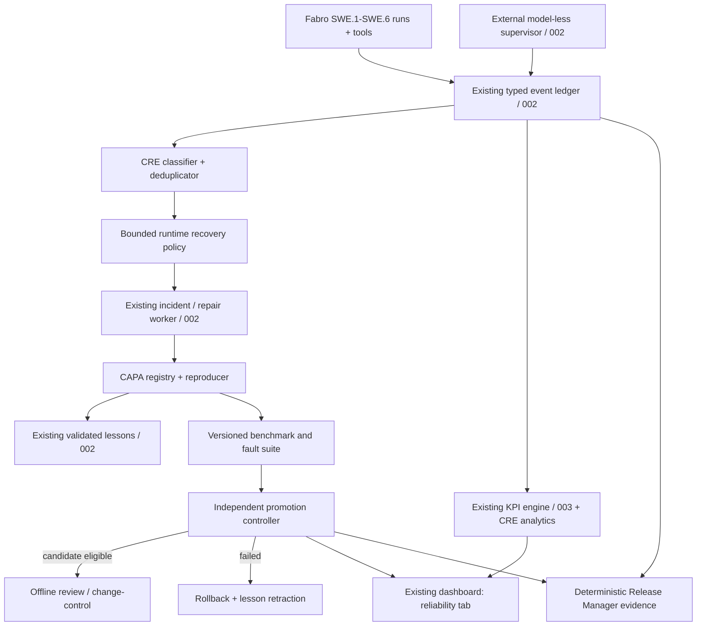

# Technical Implementation Plan — Forge-C CRE 004

**Rule:** implement as an additive reliability layer on 001–003; preserve their authoritative source of truth, versioned contracts and hard gates. This plan is a target architecture until checked against the real repository.

## 1. Build order and integration checkpoints

1. **Audit implementation reality.** Inspect code, tests, configs, event schemas, database schema, dashboard, packager, Fabro integration, skills/MCP and pinned versions. Produce a status/evidence matrix. Only after the audit decide whether an item is already implemented or is a dependency on unfinished 002/003 work.
2. **Reuse before building.** Extend 002 existing incident/repair/lesson/supervisor modules. Extend 003's K01–K20 event-based computation. Avoid second supervisor, second event ledger, shadow KPI aggregates or parallel release pipeline.
3. **Enable observe-only first.** Insert reliability telemetry and incident taxonomy without letting reliability analytics issue repair/promote commands.
4. **Add bounded control.** Integrate retry policy and CAPA in existing incident lifecycle, then install benchmark runners and independent promotion gates.
5. **Verify with chaos tests.** Simulate crashes and repair candidates. Enable `PILOT` only after strict negative tests pass; `ACTIVE` permits only pre-authorized operational changes, not autonomous persistent-code promotion or safety policy changes.

### Existing source integration map (resolve actual paths in audit)

| Existing feature/component | Reuse / extension for CRE 004 | Do not do |
|---|---|---|
| `002` supervisor/incident DB | deterministic condition classification, retry state, leases, runtime health invariants | invent a duplicate supervision daemon |
| `002` `fabric-repair` + sandbox | CAPA evidence contract and reliable candidate testing | let Repair Agent approve its own patch |
| `002` shared lessons | attach verified reproducer, regression ID, suppression/retraction metadata | inject unvalidated or poisoned knowledge |
| `002` trace collector/dashboard | typed CRE events, readonly reliability view and drilldowns | duplicate raw logs; capture hidden CoT |
| `003` work-order/KPI ledger | preserve K01–K20; add reliability analytics via formulas+versions | renumber or recompute historical KPI definitions |
| `002` release manager | versioned CRE evidence manifest and package references | mark certification/approval complete |
| `.fabro/skills` and `mcp-registry.yaml` | extend only if new AI role or tool is indispensable | bypass least-privilege via direct shell |
| `architecture/Forge-C_Fabro_DarkFactory_v0.5.drawio` | new view/tab or versioned v0.6 diagram; preserve 12-tab original | silently overwrite canonical history |

## 2. Architectural decomposition (MAPE-K plus controlled evolution)



Two loops with separate contracts:

- **Runtime recovery loop:** an observed condition produces a finite sequence of deterministic actions/checkpoints or a stable blocked state. Retry success is **not evidence of structural reliability growth**.
- **Factory evolution loop:** observed failure -> reproducible CAPA -> candidate patch -> independent regression -> documented promotion eligibility -> controlled deployment or rejection. A successful repair only becomes a reusable prevention rule after verification.

## 3. Recommended module layout (adapt to repository code conventions)

```text
factory/
  reliability/
    taxonomy.py              # deterministic symptom classifications, fingerprints
    retry_policy.py          # bounded backoff, circuit breaker, budgets
    capa.py                  # state transitions, reproducer evidence, resolution
    benchmark.py             # immutable workload manifests, cohort matching
    reliability_metrics.py   # comparisons, Wilson intervals, SPC analysis
    promotion.py             # isolated candidate evaluation and decision
    evidence.py              # CRE read-only report assembly + packager handoff
    ...                      # reuse existing persistence, API, settings and tests
config/factory/reliability-policy.yaml  # migrate supplied policy into repo config
specs/004-continuous-reliability-engineering/{spec,plan,tasks,acceptance-tests}.md
specs/004-continuous-reliability-engineering/contracts/
tests/reliability/                # exact directory chosen to match project conventions
```

**Do not create all modules above blindly.** Where 002/003 already owns a component, extend that module with a small interface and tests. Python/SQLite/FastAPI are defaults inherited from the existing planned OSS stack only after verification; no new database or framework solely for CRE.

## 4. Typed events, storage, fingerprints

Use the authoritative versioned 002 event envelope (`event_id`, UTC event time, correlation/run/work-order/stage, actor, category, evidence refs). Add CRE-specific payloads, **not a competing ledger**:

- `cre.failure_observed`, `cre.failure_classified`, `cre.retry_decided`, `cre.circuit_opened`, `cre.recovery_terminal`
- `cre.capa_opened`, `cre.reproducer_verified`, `cre.root_cause_verified`, `cre.corrective_action_applied`, `cre.preventive_test_registered`
- `cre.benchmark_completed`, `cre.promotion_evaluated`, `cre.candidate_rolled_back`, `cre.lesson_retracted`, `cre.spc_signal`

Mandatory event metadata: `schema_version`, immutable event ID, UTC time and monotonic elapsed if measured within process, stable order/workflow/incident IDs, source tool version/skill/model/policy/config hash, evidence SHA-256, causation/correlation ID, explicit source type (`DETERMINISTIC_TOOL` / `AGENT_HYPOTHESIS` / `HUMAN_REVIEW`) and redaction classification.

**Fingerprint algorithm v1** = stable hash of canonical `{failure_class, source_component, error_code, normalized_operation, tool_major_version, contract_schema_version, normalized_environment_family}`; strip timestamps, random paths, run IDs, secrets and variable log text. Avoid merging unrelated issues: split or merge only with explicit audited mapping; preserve original IDs. Root-cause hypothesis and final verified root cause are separate fields; never force a guessed cause into fingerprint identity.

Persist 002 incident transitions transactionally, with unique event IDs, deduplication leases and idempotency keys. Ensure replay yields identical final state and aggregates. Use a transactional outbox / recoverable dispatch if external actions must be triggered after DB commit. Preserve append-only historical evidence; corrections are new events.

## 5. Operational recovery — finite state machines

### Recovery states

```text
DETECTED -> CLASSIFIED -> RETRY_ELIGIBLE -> RETRY_SCHEDULED -> CHECKING_HEALTH
                   |              ^                         |           |
                   |              +----(remaining budget)---+           +--> RECOVERED
                   +--> REPAIR_ELIGIBLE -> REPAIR_DISPATCHED -> CHECKING_HEALTH
                   +--> REQUIRES_OFFLINE_ATTENTION (terminal)
RETRY/REPAIR paths -> EXHAUSTED -> REQUIRES_OFFLINE_ATTENTION (terminal)
```

Enforce allowed transitions in code, not prompts. Each incident has durable lease/idempotency keys, max retries/time/tokens and a total attempt budget. Exactly one active repair lease per fingerprint/scope is allowed; multiple distinct work orders may link to the same incident without losing causation. Crash/restart cannot reset budgets. Stale leases expire only with safe recovery rules.

Retry policy classification:

| Class | Allowed behavior | Explicitly prohibited |
|---|---|---|
| Network timeout / 429 / temporary MCP unavailability | bounded exponential backoff + jitter and circuit breaker; retry only when idempotent | infinite rapid retry or duplicated side effects |
| Deterministic compiler/test failure | no blind retry; route to SWE author/inspector rework, using 002 independent review | infrastructure Repair Agent patching product baselines |
| Unresponsive Fabro/worker | external supervisor checks; one isolated repair/controlled restart if policy authorizes | repair that only Fabro itself can launch |
| Disk full / DB unavailable / evidence store corruption | stop writes safely, preserve recovery markers, BLOCKED until durable store verified | logging PASS with missing evidence |
| Policy/security violation, unknown external side effect | fail closed, preserve forensic data, mark offline attention | automatic safety-rule changes or reflash |

**Idempotency matrix:** tag every action `REPLAY_SAFE`, `REPLAY_WITH_IDEMPOTENCY_KEY`, `COMPENSATABLE` or `NON_REPLAYABLE`. Never auto-replay `NON_REPLAYABLE` operations such as flashing hardware, approval, changing signed releases or modifying frozen baselines. Time budgets and backoff use a monotonic clock within one boot; persist UTC checkpoint deadlines and handle clock jumps/restarts conservatively. The terminal state is explicit even when repair cannot be dispatched.

### Formal-style properties to test

- **Safety:** `G(not gate_bypassed)`; `G(promotion -> independently_verified)`; `G(original_evidence_immutable)`.
- **Bounded liveness (under explicit scheduler/storage fairness assumptions):** every admitted incident reaches `RECOVERED` or `REQUIRES_OFFLINE_ATTENTION` within the configured attempts and logical state transitions. External infrastructure outages may delay wall-clock observation; in that case preserve a durable unresolved incident and an external watchdog escalation.
- **Closure on verified healthy configuration:** supervisor cannot modify healthy valid state merely due to routine polling; a new external fault can of course violate health.

Use table-driven state tests, property-based generation where available and fault injection. Do not claim Dijkstra's universal convergence proof for nondeterministic agents/external dependencies.

## 6. CAPA and lessons

CAPA states: `OPEN -> TRIAGED -> REPRODUCER_PENDING -> CAUSE_VERIFIED -> FIX_CANDIDATE -> PREVENTION_TESTED -> EFFECTIVENESS_OBSERVING -> EFFECTIVE` with `REJECTED/UNRESOLVED/REOPENED` routes; different records may advance asynchronously. Explicit root-cause statuses: `UNKNOWN`, `HYPOTHESIS`, `VERIFIED`. Verification requires (1) original symptom reproduced against vulnerable baseline, (2) causal contrast or compelling direct measurement, (3) observed fix under independent runner, and (4) a regression/preventive test linked to the root cause. An AI summary alone is insufficient.

Every CAPA record must link to original incident IDs, evidence hashes, version/toolchain context, proposed patch, verified test ID, risk category, observed effectiveness cohort/window and lesson state. Failed fixes remain recorded and reusable only for diagnosis, not injected as advice.

Knowledge retrieval uses the **existing 002 validated lessons service** (max K=3 by existing policy unless approved change), with `affected_versions`, `reproducer_id`, `prevention_test_id`, `root_cause_confidence` and `retracted_at` as additive fields. Validate prompt-injection/poisoning threats. A recurrence triggers re-evaluation, not silent claims of permanent elimination.

## 7. Versioned evaluation benchmark

Add `benchmark-suite.yaml` with the actual set of representative workloads, not generic hello-world alone. Proposed initial categories:

1. host RCC driver, known good baseline + invalid-source/compiler failure;
2. GPIO or UART register-level driver fixture with concurrency/interrupt boundary and deterministic injection;
3. deliberately broken static-analysis/MISRA-subset fixture;
4. tool availability/timeout and evidence-store interruption fixtures;
5. end-to-end SWE.1–SWE.6 and packager fixture once 002 is actually operational.

The first MVP may start with RCC + 3 reproducible injected failure classes. Include fixed public **golden** fixtures and an **independently maintained holdout** set inaccessible for editing by repair agents. Each case pins source/requirements SHA, MCU/compiler/options, Fabro and model versions, safety/evidence profile, tool dependencies, seed if supported, evaluation function and original known expected result. Cases lacking a real supported dependency are `NOT_RUN/NOT_COMPUTABLE` rather than a fake pass.

Compare baseline and candidate on **same eligible cohort**. Do not compare different MCU families, driver complexities, ASIL profiles or compiler optimizations as homogeneous observations. Count unique work orders for final yield, immutable first inspection for first-pass, and link attempts to the same order. Exclude no failures merely because they increase cost.

For probabilistic model outputs: freeze models/sampling/config where technically possible, run independent repeated instances with known sample sizes and separately report stochastic variation. Holdout must remain outside candidate's tool grant scope. Do not adapt tests until a candidate passes; changes to the benchmark are separately versioned and require a new baseline comparison.

## 8. CRE metrics and statistical decision policy

Preserve all existing manufacturing definitions K01–K20. In particular, K16 autonomous recovery effectiveness and K17 recurrence ratio are already specified; do not duplicate as conflicting KPIs. Introduce an **additive diagnostic namespace** `CRE-R01` etc. and cross-link source events:

| ID | Diagnostic metric | Formula / evaluation |
|---|---|---|
| CRE-R01 | Workflow first-attempt success | unique eligible work orders completing defined target workflow on first attempt / total eligible work orders; distinct from per-station FPY, whose initial independent verdict is immutable |
| CRE-R02 | Retry amplification | total eligible action invocations / unique intended actions; report excess attempts separately; clarify partial/no-data |
| CRE-R03 | Recurring failure events | count of post-fix matching fingerprints / eligible observation interval; accompany K17 distinct-fingerprint recurrence ratio |
| CRE-R04 | Recovery time p50/p95 | durations of terminal eligible incidents, distinguishing recovered from unresolved/censored; never use only successful incidents to imply global recovery SLA |
| CRE-R05 | CAPA effectiveness | verified CAPAs with completed observation window and no recurrence / all verified CAPAs with completed window; no observation = NOT_COMPUTABLE |
| CRE-R06 | Candidate rejection/rollback | candidate count rejected or rolled back / total evaluated; report reason categories and safety veto counts |
| CRE-R07 | Cost per accepted package | actual or provenance-labelled estimated inference+compute cost / unique READY package; zero READY => N/A |
| CRE-R08 | Escaped defect/late detection | defects detected downstream of origin phase / eligible verified defects; report phase/origin inference confidence, unknown when not verifiable |

**Statistical analysis:**

- For success/failure proportions use Wilson 95% confidence intervals, with exact numerator, denominator and independence/comparability assumptions. For no failures in n independent tests, upper 95% bound is approximately `3/n` (rule of three), not zero.
- For correlated workflow runs, stratify/cluster by work order, model/tool revision, target and batch; do not use naïve independence-based confidence bounds as definitive if correlations remain.
- SPC in measurement-only mode at first. Calibrate center line and limits per stable comparable cohort. Use p-charts when binomial assumptions and subgroup counts are meaningful; EWMA optionally for temporal drift, including the chosen lambda, control limits and calibration version. Alert is **diagnostic**, not automatic policy change.
- Promotion **must** pass every hard gate and benchmark sentinel, regardless of estimated positive KPI trend. Non-regression on finite benchmarks does not prove untested safety. Insufficient sample/unknown evidence yields `INCONCLUSIVE`, not positive reliability claims.
- Duane/AMSAA reliability-growth fitting is optional **P2 diagnostic only**, must state fit assumptions, observation clock, censored exposures and uncertainty; never auto-promote based on a fitted trend.
- Initial config must avoid invented FPY/SPC baseline values. Save calibration window/validity metadata. Choose workload-specific SLOs after pilot data; do not hardcode invented observed baselines.

## 9. Independent Promotion Gate (two-stage acceptance)

`PROPOSED -> QUARANTINED -> REPRODUCED -> PATCHED -> EVALUATING -> {REJECTED, INCONCLUSIVE, ELIGIBLE_FOR_OFFLINE_REVIEW}`.

Candidate requirements:

1. Clean isolated worktree and OS-level restricted execution context; patch scope must be allowlisted and never touch safety/security/release approvals or test oracle assets.
2. `pre-fix` reproduction of exact incident against baseline plus `post-fix` independent reproduction test; run tool contract, unit, regression, evidence/trace/ASPICE gate integrity, protected file hashes and security tests.
3. Baseline/candidate comparison on frozen golden plus holdout; report pass/fail, duration/tokens, covariance/sample sizes as applicable, changes in cost and failed-first-pass outcomes.
4. Promotion policy is **not an LLM prompt**: deterministic runner produces a signed-or-hashed `promotion-decision.json` containing `decision`, gate-by-gate evidence refs, input hashes, policy version and reason codes. The patch author cannot edit the runner, policy or benchmark fixtures.
5. If health degrades after a sanctioned reversible operational intervention, restore known good configuration (atomic switch and rollback), preserve last-good artifacts, retract affected lessons, emit incident.
6. Initial v004 **never auto-promotes persistent factory code to production**; it may mark candidates `ELIGIBLE_FOR_OFFLINE_REVIEW`. Existing authorized offline change-control owns code promotion. In active mode only pre-approved low-risk, reversible operational actions (e.g. process restart or queue-drain under policy) may be automatic.

Hard gate order: **protected files / security** -> **reproducer** -> **safety/process/quality** -> **existing regression** -> **holdout** -> **statistical/efficiency evidence** -> **change-control disposition**. On a hard failure, do not run unnecessary expensive LLM evaluations. No candidate can change its own thresholds or tests to force a pass.

## 10. Dashboard and user controls

Add an integrated read-only "Reliability" view under the existing dashboard and trace system, with current operational state, unresolved incidents, CAPA effectiveness, recurrence Pareto, FPY/first-attempt trend, recovery distributions, retry amplification, token/cost, p-chart/EWMA when valid, promotion/rejection timeline, and one-click (authorized) drilldown to immutable evidence and relevant trace ID. Support period, model, driver/MCU class, Fabro version, toolchain, candidate/baseline and fault category filters. Display data status, sample counts, confidence intervals, cutoffs and last update. Never infer current safety readiness from a green metric tile.

Preserve the existing ten trace channels (`human`,`workflow`,`tools`,`ai`,`supervisor`,`repair`,`security`,`audit`,`metrics`,`knowledge`) and add CRE event subtypes/tags. Existing capture-policy choices remain independent of display filters. Mandatory audit/security capture can never be switched off via the UI. No hidden chain-of-thought, secrets or raw compiler logs in agent context.

## 11. Release evidence + Automotive SPICE mapping

Release Manager adds a hashed `reliability/` bundle to both READY and BLOCKED packages:

- `baseline-manifest.json` (all pinned versions/constraints and source hashes)
- `incident-capa-ledger.jsonl` (versioned, redacted, evidence refs)
- `reliability-kpi-snapshot.json` (formula versions, denominators, statuses, confidence metadata)
- `benchmark-report.json` and `fault-injection-report.json` (cases, executable tests, exit codes, raw evidence refs)
- `promotion-decisions.jsonl` (policy version, gate outcomes, candidate and baseline hashes)
- `spc-analysis.json` (`NOT_COMPUTABLE` with reasons when appropriate)
- `lessons-ledger-index.json` (approved/retracted lesson IDs, impact)
- `readiness-assessment.json` (supported claims, missing prerequisites, approved modes, never safety signoff)

Align the process evidence **by activity**, subject to the project's approved PAM: SUP.9 (problem resolution), MAN.6 (measurement), PIM.3 (process improvement), and quantitative analysis/control as applicable; maintain SWE.1–6 evidence integrity. Do not infer achieved PA levels or quietly upgrade ASPICE v4.0 to a different revision. Preserve existing Release Manager invocation and offline human review; no secondary packager that bypasses gate state.

## 12. Security, integrity and cost controls

- Separate credentials/OS users/file permissions for production runs, repair worktrees and verification runner. Do not rely only on agent instructions, regex matching of paths or Git diff guards.
- Limit MCP path scope, subprocess argv, concurrency, resource usage and network egress; inherited security constraints stay intact.
- Validate incident/lesson payloads as **untrusted data** (prompt injection defense); never let a failure log request an arbitrary command.
- Keep hashed raw evidence outside LLM context; tool MCP returns `status`, short issue codes, bounded diagnostics and artifact refs. Use native counters for tokens/CPU/GPU and label estimates as estimates.
- Supervisor healthy poll consumes zero tokens; AI analysis only after deterministic class/rule selection indicates a nontrivial, eligible problem. Reuse approved lessons before requesting expensive root-cause diagnosis, but still verify facts.
- Cap per-incident LLM turns/tokens, retries and total recovery budget; resource exhaustion is a legitimate BLOCKED outcome.

## 13. Rollout and deliverable boundaries

| Stage | Mode | Entry criteria | Exit deliverable |
|---|---|---|---|
| D0: Inventory | no CRE writes | existing tests and versions identified | capability matrix, baseline hashes, missing P0 dependency list |
| D1: Event+CAPA | OBSERVE_ONLY | durable 002 event/incident records | deterministic taxonomy/fingerprints, structured CAPA, retry measurement |
| D2: Recovery control | PILOT in isolated harness | 002 repair supervisor working and tests | finite recovery and crash/restart guarantees |
| D3: Benchmark/gate | PILOT | frozen independent fixtures and build tools | reproducible no-regression evidence and deterministic candidate decisions |
| D4: SPC and dashboard | OBSERVE_ONLY/PILOT | stable workload cohort data | confidence-labelled trend reports and integrated UI |
| D5: E2E validation | PILOT | all mandatory P0 tests passing | adversarial/fault runs, reproducible offline package |
| D6: Controlled operations | ACTIVE only per authorization | offline human disposition + documented runbook | bounded low-risk self-healing, not self-authorized source promotion |

Dependencies can block a stage. Example: feature 002 is still `SPEC_ONLY` for real Fabro service discovery, so run only mocked contract tests and report PILOT/ACTIVE as BLOCKED until real integration passes. A mock result is not a production green status.

## 14. Evidence and technical references

- Spec Kit feature/implementation convergence: https://github.com/github/spec-kit/blob/main/docs/guides/evolving-specs.md
- Circuit breaker: https://learn.microsoft.com/en-us/azure/architecture/patterns/circuit-breaker
- Bulkhead/isolation: https://learn.microsoft.com/en-us/azure/architecture/patterns/bulkhead
- NIST Engineering Statistics Handbook: https://www.itl.nist.gov/div898/handbook/
- SRE — monitoring distributed systems: https://sre.google/sre-book/monitoring-distributed-systems/

## 15. Key implementation ADRs that Claude must write

- ADR-CRE-001: exact reuse points for 002 incident, supervisor and DB, with migration strategy.
- ADR-CRE-002: fingerprint algorithm/collision management and CAPA mapping.
- ADR-CRE-003: reliable event ordering, idempotency and restart semantics.
- ADR-CRE-004: immutable benchmark/oracle and independent promotion authority.
- ADR-CRE-005: statistical sampling/SPC thresholds and data quality policy.
- ADR-CRE-006: operations eligible for autonomous recovery vs forbidden production mutation.
