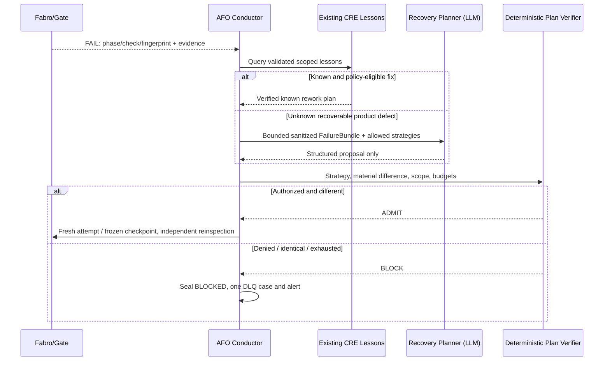

# Feature 005 — Detailed Architecture and Responsibility Boundaries

**Status:** design only. AFO does not replace Fabro, the existing supervisor, the CRE promotion gate, the event ledger, the dashboard or the Release Manager. The identified source paths are verified in the 004 tree but must be re-audited at implementation HEAD.

## 1. Component map and proposed source destinations

| Capability | Extend existing location | New implementation destination (proposed) | Governing authority |
|---|---|---|---|
| Work order input, workspaces and launch | `factory/python/forge_factory/workorder.py` | `forge_factory/conductor/{intake,adapter}.py` | approved manifest + current `workorder` validation |
| Durable scheduler, queue and leases | existing `state_dir()`/common helpers | `forge_factory/conductor/{store,models,scheduler,service}.py` | AFO policy, fencing CAS and SQLite outbox |
| Fabro execution/reconciliation | `forge_factory/fabro/client.py`, `fabro/runconfig.py` | `forge_factory/conductor/{reconcile,dispatch}.py` | authoritative Fabro API/CLI receipts; never guessed run IDs |
| SWE stage failures and checkpoints | `inspection/{gate,engine,defects,reverify}.py`, `workflow/builder.py` | `forge_factory/conductor/{failures,checkpoint,replan}.py` | independent gate/inspector verdicts + frozen hashes |
| Runtime repair and known lessons | `supervisor/*`, `repair/worker.py`, `knowledge/store.py` | thin adapters only | 002 infrastructure and 004 retry budgets, no competing router |
| Agent planning of product rework | current SWE author and inspector roles, MCP registry | `.fabro/skills/afo-recovery-planner/SKILL.md`, `forge_factory/conductor/planner.py` | bounded skill output + policy-validation broker |
| Factory source maintenance proposal | `reliability/{capa,promotion,protection,reproduce}.py` | `.fabro/skills/afo-factory-maintainer/SKILL.md`, `forge_factory/conductor/maintainer.py` | sandboxed candidate and external code change control |
| Alerts / DLQ | `events/`, `dashboard/app.py` | `forge_factory/conductor/{deadletter,alerts}.py` | idempotent outbox, local fallback |
| SLO / release evidence | `kpi`, `reliability/{metrics,readiness}.py`, `release/finalize.py` | `forge_factory/conductor/{metrics,readiness,evidence}.py` | deterministic event analytics and existing sealed packager |
| 24/7 services | `deploy/systemd/forge-supervisor.service.in`, `scripts/forge_services.sh` | `deploy/systemd/forge-{ollama,gateway,fabro,dashboard,conductor}.service.in` | systemd host/service manager, preflight mount, owner approval |
| Observation UI | `dashboard/app.py`, `dashboard/static/index.html` | `/api/v1/autonomy/` and Autonomy panel | read-only by default, separate authenticated controls |

New files above are proposed destinations, not evidence they exist. Claude may adapt names if a better non-duplicative integration exists and records the ADR.

## 2. Control sequences

### Approved order and normal run

```mermaid
sequenceDiagram
    participant Owner as Authorized submitter
    participant Queue as AFO DB/Outbox
    participant AFC as Conductor
    participant Fabro as Fabro 0.362
    participant Gate as Existing SWE Gates
    participant Seal as Release Finalizer
    Owner->>Queue: Approved manifest, hash, request_id
    Queue-->>Owner: Existing or new stable order_id
    AFC->>Queue: CAS admission, fence, durable intent
    AFC->>Fabro: CLI launch unique attempt label (authorized)
    Fabro-->>AFC: run_id (possibly lost/unknown)
    AFC->>Fabro: Reconcile authoritative receipt/status
    Fabro->>Gate: SWE.1–SWE.6 author/independent inspector
    Gate-->>AFC: Frozen pass/fail evidence, hashes
    AFC->>Seal: Validate terminal archive via existing finalizer
    Seal-->>Queue: READY only after all gates; else BLOCKED
```

### Replan after SWE gate fail



### Factory source issue

AFO observes an error potentially originating from source/skill/workflow/MCP implementation; `factory-maintainer` prepares a *candidate in isolation*, independently checks that baseline reproduces failure and candidate does not, then sends the candidate through CRE promotion to `ELIGIBLE_FOR_OFFLINE_REVIEW` **only**. A deterministic privileged broker may create a PR if externally configured and authorized. No model can write `main`, restart production to a candidate, weaken security or edit immutable acceptance oracles. The affected order may wait for external change only under a bounded TTL; others proceed.

## 3. Trust boundaries and principal separation

```text
Host service account A: systemd + Conductor + approved Fabro production workspaces
Existing 002 supervisor: separate OS process, model-free; service recovery independent of Conductor
Existing 004 verifier: rootless Podman sub-UID (independent protected tests/holdouts)
Planner agent: reads sanitized bounded product-failure refs only; cannot edit product directly
SWE author: bounded MCP writes only within current product worktree
SWE inspector: independent role and frozen workproduct checklist; no source writes
Factory Maintainer: isolated candidate sub-UID; candidate code and proposal only
Change-control operator: separate externally authenticated signer for mode change and source deploy
Release authority: human/organizational offline reviewer, never any runtime agent
```

Agents may not call service control, credentials store, systemctl, root shell, general git or GitHub APIs directly. Narrow deterministic MCP operations only. Production access to OS mounts and host service manager is brokered by audited non-AI services. Separate signed authorization is required for any production-affecting mode change.

## 4. Existing contract intersections and precedence

Precedence highest to lowest: constitutional/safety/approved requirements and OS confinement, then 002 mandatory gates and identities, 004 CRE hard invariants/authorization, 003 metric integrity, then AFO budgets and operator envelope, then an AI proposed plan. At each intersection, use the **most restrictive** allowed action. AFO ACTIVE cannot override CRE OBSERVE_ONLY for an operation requiring CRE ACTIVE.

Use existing CRE CAPA fingerprint and lesson IDs. Do not duplicate `cre_promotion_decisions`, `incidents`, `incident_history`, `repair_attempts`, KPI-003 catalog or protected release policy. AFO adds correlations and scoped fields; should be safe when 004 is upgraded or policy reload is rejected.

## 5. No automatic source promotion and the autonomy paradox

The owner wants the factory to correct itself without prompts. Within the safety-related embedded domain, unlimited autonomous persistent source mutation would let an LLM modify the very gates that verify it. This is unacceptable. Therefore the architecture differentiates:

- **Autonomous operational correction:** restart eligible services, retry replayable work, resume/checkpoint, scoped product draft rework, propose verified alternate strategy. Allowed within signed policy and bounded budgets.
- **Autonomous engineering preparation:** create Forge-C bug reproducer, candidate patch and independent report, staged branch/PR. No human prompt required for diagnosis or patch production; *external authorization* may remain necessary for code promotion.
- **Never automatic:** safety approval, gate/oracle changes, approved requirement changes, persistent factory source deploy, firmware flashing or organization release authority.

Failing to reach READY despite correct safeguards is a truthful BLOCKED engineering outcome, not a violation of continuous service operation.

## 6. Fixed known interfaces and likely implementation traps

- `workorder.launch_run` currently guards `workorder_launch:<wo>` and parses CLI stdout. The new order/attempt distinction needs an idempotency compatibility ADR; do not reuse an order-level `ALREADY_DONE` receipt for a second attempt.
- `FabroClient.list_runs` and `get_run` are **read-only observed** API methods; don't call undocumented Fabro resume APIs or assume label uniqueness unless independently verified.
- `Supervisor.external_finalizer` currently polls terminal Fabro runs when Fabro reachable. AFO must coordinate exactly one package seal and not create competing finalizer threads.
- CRE `readiness.py` contains a manually unresolved sign-off check and `OBSERVE_ONLY` by design. Feature 005 must not turn it true from user-supplied text or derive authority from a generated document.
- Root README says pilot. No 005 gate, PR or pipeline can claim ISO 26262 tool qualification, ASPICE rating or production-release approval.
