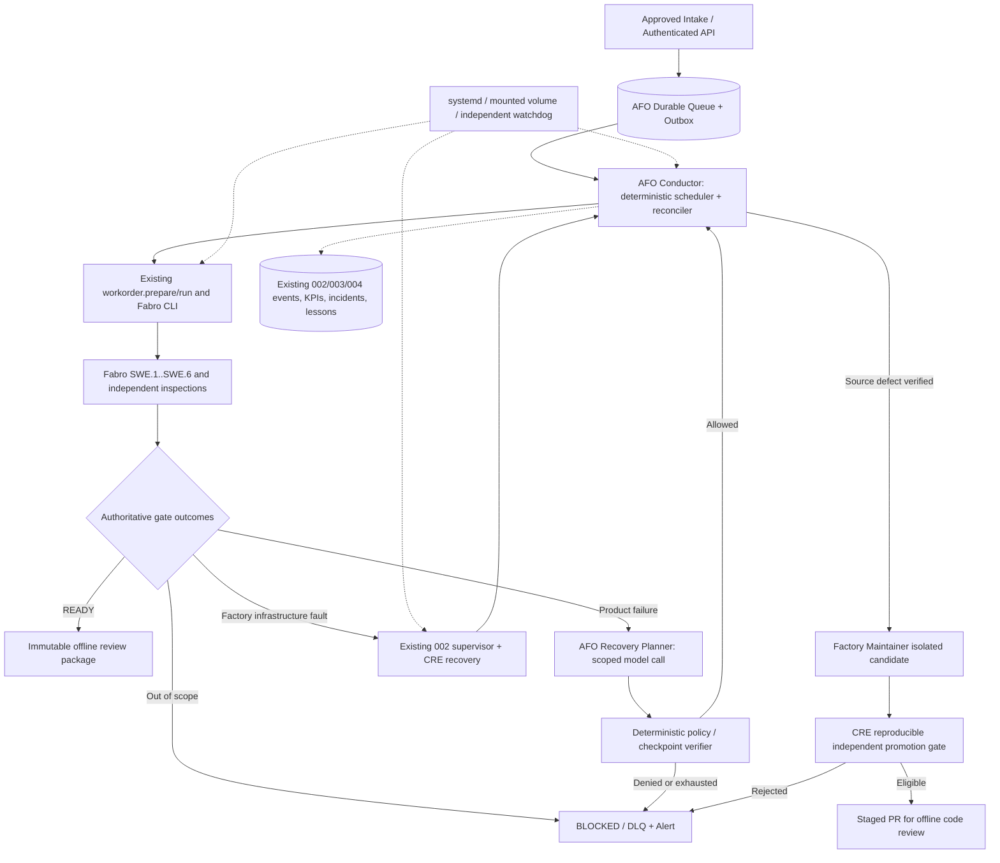

# Implementation Plan — Feature 005: Autonomous Factory Operations (AFO)

**Branch:** `feat/005-autonomous-factory-operations` | **Date:** 2026-10-17 | **Status:** design + implementation backlog, NOT production code  
**Specification:** [spec.md](spec.md) | **Base dependency:** Feature 004 branch currently at `c03c0da9e771eddfdfb24b02d8ec336dfa847dfa`; Claude must refresh its actual checked-out SHA before any work.

## Summary and execution strategy

Build the minimum additional deterministic **Autonomous Factory Conductor** process and durable queue. Do not build another model-less supervisor, incident database, failure taxonomy, promotion gate, KPI engine or release packager: Features 002/003/004 already own these capabilities. AFO owns *work-order lifecycle and scheduling*, *cross-run reconciliation*, *policy-bound SWE recovery plans*, and *human-free routine operational continuity*. Reuse the current Fabro API/CLI (`forge_factory.fabro.client`, `forge_factory.workorder`) and CRE event journal. The source Maintainer agent only submits isolated *proposals*, not autonomous source promotion.

### Technical context

| Dimension | Design decision |
|---|---|
| Host | Ubuntu 22.04/24.04, systemd, headless, stable mounted FORGE_DATA_ROOT |
| Primary implementation | Existing Python 3.13/venv and `factory/python/forge_factory/`; no dependency churn unless justified |
| Orchestration | Keep Fabro 0.362 SWE graph; no replacement orchestration engine |
| Persistent state | `FORGE_STATE_DIR/conductor/conductor.sqlite3`, SQLite WAL/synchronous=FULL; *existing* 002/004 stores are referenced by stable IDs only |
| Journal | Reuse CRE SideEffectJournal for existing guarded operations; AFO transactional outbox for conductor commands and external receipts; reconcile cross-DB updates, no unsafe distributed-transaction assumptions |
| Runtime default LLM | On-prem Ollama Qwen via existing model gateway; permitted cloud profiles only if explicitly user-approved |
| Agent tool access | Existing MCP authz/skills; new `afo-recovery-planner` and `afo-factory-maintainer` SKILLs, narrow tool grants, existing independent inspection/gate runner |
| Dashboard | Extend existing read-only FastAPI/JS dashboard routes with `/api/v1/autonomy/*`; authenticated write operations are separately controlled and off by default |
| Deploy | systemd user units for Ollama/gateway/Fabro/dashboard/Conductor/supervisor, with real condition probes, persistence, and watchdog; rootless Podman verifier where available |
| Test | pytest, schema validations, existing design checker, full 001–004 regressions, process and reboot drills, 168h soak |

## Constitution and compatibility gates (M0)

- Revalidate `.specify/memory/constitution.md` sections I–X. AFO is additive; no silent changes to constitutional prohibitions.
- Existing paths to inspect: `factory/python/forge_factory/{workorder.py,workflow/builder.py,supervisor/service.py,supervisor/dispatch.py,repair/worker.py,reliability/{recovery.py,production.py,readiness.py,promotion.py,supervisor_hook.py,store.py},kpi,events,release}`; `config/factory/{reliability-policy,supervisor-policy,agents,mcp-registry,token-policy}.yaml`; `scripts/{forge_services.sh,forge-env.sh,install_supervisor.sh}`; `deploy/systemd/forge-supervisor.service.in`; `docs/adr/ADR-CRE-006-autonomous-recovery-scope.md`.
- File may have moved/changed; inspect HEAD and use a new ADR when observed behavior conflicts with assumptions. In particular, the 004 PR is in `OBSERVE_ONLY`, its `readiness.py` includes a hardcoded signed-runbook gate and evidence may claim E2E PASS even for a BLOCKED package. Treat those as *known distinctions*, not license to relax gates.
- No auto-edit to existing protected oracle/safety/release/authorization files by the proposed autonomous worker. Claude is an implementation engineer; it may propose audited code changes where relevant in feature branch, but release configuration remains explicitly owner-controlled.

## Architecture: control plane and authority

**Ownership:** Conductor owns queue state but not verification truth; Fabro owns run history, SWE gates own quality, release.finalize owns immutable packaging, 002 owns infrastructure incident repair, 004 owns incident taxonomy, CAPA, side-effect classification and promotion decision, OS owns process restart; operators alone own authorization to deploy persistent code and approve safety-related changes.

## Milestones, exit gates, and task ordering

| Milestone | Outcome | Exit evidence |
|---|---|---|
| M0 (T001–T006) | Audited implementation baseline, mode/authority matrix, pinned host prerequisites | source inventories, ADR, regression logs, no invented live capabilities |
| M1 (T007–T015) | 24/7 service lifecycle and stable mounted data | power/session/logout/start/kill probes, no orphan daemons, watchdog evidence |
| M2 (T016–T025) | Durable approved work order intake, scheduler and fair admission | transactional duplicate/restart/concurrency tests |
| M3 (T026–T034) | Run/attempt/checkpoint reconciliation and side-effect safety | crash-window tests for prepare/launch/run/finalize, no double writes |
| M4 (T035–T044) | Autonomous failure triage, bounded SWE replanning and retrial | real gate receipt ingestion, independent inspections, altered-strategy proof, non-success terminal |
| M5 (T045–T053) | Safe factory source maintenance candidate + independent gate | versioned SKILL/MCP authz, sandbox tests, PR proposal only |
| M6 (T054–T061) | DLQ, alert, status dashboard and preserved evidence | blocked work isolated, read-only visibility, authenticated pause/drain |
| M7 (T062–T070) | Staged pilot, real process-failure drills, 7-day soak and SLO reporting | honest `NOT_DEMONSTRATED` until real observation samples, 24h/72h/168h logs |
| M8 (T071–T075) | Integration/security/release validation and handoff | full test matrix, code hashes, operator runbook, final status |

Complete milestone prerequisites in order; safely parallelizable tasks explicitly tagged `[P]`. Do not consider the full feature COMPLETE just because tests and spec tasks were written: a real pilot is separate evidence.

## M1 design: restart and data volume

- Convert `forge_services.sh` lifecycle to managed `systemd --user` services; keep current CLI as compatibility wrapper. Do **not** use `nohup` as 24/7 guarantee.
- `forge-ollama`, `forge-llm-gateway`, `forge-fabro`, `forge-dashboard`, `forge-conductor` and pre-existing `forge-supervisor` use `Restart=on-failure` or `always` with bounded start-limit/backoff; watchdog only when code sends valid READY/WATCHDOG notification. Use `Type=exec`/`simple` otherwise; verify actual platform version supports the chosen syntax. Unit ordering does not replace readiness probes.
- Configure persistence by UUID in `/etc/fstab` or an appropriate `.mount` unit under the operator's explicit host configuration. Document `loginctl enable-linger <user>` as an operator-authorized prerequisite; **never** secretly invoke sudo from production agents. Use `RequiresMountsFor=<absolute FORGE_DATA_ROOT>` and a preflight sentinel/writable filesystem check. Mount failure leaves services inactive/alerted, never writes to the unmounted path.
- Store authentication via systemd credentials or protected environment files outside Git. No agent read grants for those paths. User service restarts survive logout and reboot only after installation prerequisites pass.
- Independent external watchdog checks Conductor heartbeat even if Conductor or supervisor hangs; direct service restarts occur through systemd, not an AI agent.

## M2–M3 design: queue, leases, idempotency and reconciliation

- Authorized immutable work order key = `tenant_scope + request_id + manifest_sha256`; in this single-user pilot `tenant_scope='local'`. Authenticated submit of same id+hash returns same queue ID; same id with different manifest rejects `409`. A new attempt is **not** a new work order.
- Store `work_orders`, `work_attempts`, `checkpoint_refs`, `operator_actions`, `conductor_leases`, `outbox`, `dead_letters`, `notifications` in an additive SQLite schema under a Conductor-specific DB. This is an authority separate from 002/004 incident state; link IDs, do not mirror mutable incident truth.
- Exactly one admitted scheduler leadership lease and fencing epoch at a time. Worker admission uses `BEGIN IMMEDIATE` and conditional transition. Expired leases permit takeover *only after* comparing current Fabro run state and reconciliation receipts.
- Use transactional outbox and monotonic command ID for external dispatch. Fabro CLI `run --detach --auto-approve` has no demonstrated idempotent server-side create key; if the CLI may have launched but no run ID receipt was persisted, list Fabro runs by unique signed work-order label/creation interval and reconcile. If multiple matches, quarantine; if none but API unavailable, mark UNKNOWN rather than relaunch. Never claim strict exactly-once process execution; require effectively-once logical work-order accounting.
- Every approved stage checkpoint stores revision hash, upstream dependency digest, inspector verdict refs and stable phase id. `--resume-from` is only a documented work-order-level resume, not proven native Fabro continuation. Safe recovery produces a new attempt ID and a fresh work-order attempt label while linking the original order; no overwriting previous archive or revision. Revalidate downstream inspections if upstream hash changed.
- Cross-DB event publication uses outbox with stable event_id, replay dedup and eventually consistent joins; no two-database atomicity claim.

## M4 design: product failure and strategy change

- Distinguish `PRODUCT_QUALITY` from `FACTORY_CODE_DEFECT` and transient dependency errors. Fabric repair (`repair/infra.py`) owns only runtime/services; never route product failure to it.
- Capture authoritative structured failures from `inspection/gate.py`, defect register, compiler/test MCP results, current attempt hashes, Fabro node status and stage history; avoid interpreting an LLM's `PASS` text as a verdict. Canonical signature strips volatile identifiers but retains phase, check, failure mechanism, tool/version and source revision.
- Try deterministic known fix rules/validated lessons first. If none applies, call `afo-recovery-planner` once with bounded token context, proven original inputs, allowed strategies and explicit denial list. The planner returns a typed plan, not prose, and does not execute it.
- Strategies: `REWORK_LOCAL`, `RESTART_FROM_LAST_VALID_CHECKPOINT`, `RETURN_TO_OWNING_UPSTREAM_PHASE`, `SWITCH_PREAPPROVED_MODEL_PROFILE`, `DEFER_TRANSIENT_DEPENDENCY`, `CLOSE_BLOCKED`. A separate policy/gate checks legality, effect scope, model authorization, budget and observed material difference. A variant changing only a random seed or prose with unchanged signature/diff is rejected as identical.
- A material change means a changed *controlled artifact digest / testable technique / issue scope* with a new plan fingerprint. A different model may help but must be pre-authorized and all downstream gates re-run; never silently switch to cloud/paid APIs.
- Distinguish (a) rework of a product's code within approved acceptance criteria from (b) editing the factory's own code, prompt or skill. AFO can autonomously re-author product drafts within bounded valid paths and launch another work-order attempt; factory source changes are routed to M5 staging.
- A plan that would modify locked requirements, test oracles, gate thresholds, safety policies, immutable evidence, release archives or approved HSI fails closed.

## M5 design: source Maintainer staging, without unsafe auto-promotion

- Extend current 004 CAPA + reproducer + independent CRE promotion runner. Create two new SKILLs only if no current role meets the required least-privilege separation: `afo-recovery-planner` and `afo-factory-maintainer`. Do **not** extend runtime infra `fabric-repair` rights to all source files.
- Maintainer gets a minimal incident/reproducer bundle, isolated unprivileged Git worktree, approved narrow file allowlist (non-protected code/skills/workflows only), no write access to independent tests, baselines or holdouts, and no prod secrets. A deterministic broker owns Git/CI and supplies only constrained MCP operations.
- Maintainer produces a patch, new tests in candidate-owned `tests/` namespace (cannot modify frozen suite or accepted oracles), and a reproducible failure-on-baseline / pass-on-candidate demonstration. Existing independent CRE evaluator runs baseline-vs-candidate tests, full frozen reproducer set and holdout, security and policy integrity. `ELIGIBLE_FOR_OFFLINE_REVIEW` yields a proposed branch/PR; **never** auto-merge, auto-rebase main, restart deployed production to candidate or change CRE `auto_promote_persistent_code: false`.
- AFO continues the rest of the queue on the last stable version and marks the affected work order `BLOCKED` or `WAITING_EXTERNAL_CHANGE` with bounded TTL; never spins forever awaiting a PR review.

## M6–M7 design: operator experience and measurable acceptance

- Implement read-only `/api/v1/autonomy` alongside existing dashboard. Authenticated operator endpoints are *separate*, auditable, rate-limited, CSRF protected where appropriate. Internal HTTP server binds loopback by default, with no remote exposure without an explicitly configured reverse proxy.
- Add immutable DLQ entry with fingerprint, owner, stage, artifact refs, reason and required action. Alert once per incident with dedup/backoff; channel adapters optional but log/local notice always works. Do not queue a new attempt automatically solely because a notification was sent.
- Distinguish `control_plane_availability`, `recovery_without_prompt_rate`, `orders_ready_yield`, `order_attempt_success_rate`, `interventions_per_order`, `p95_mttr`, `duplicate_effect_count`, `circuit_open_time`, `idle_healthy_seconds`, `cost_per_ready` and `unknown_denominator`. Use source event refs, fixed cohorts and confidence intervals via existing 003/004 metric infrastructure. Do not relabel old `BLOCKED` as ready.
- Soak program: 24h non-interactive smoke (one worker), 72h pilot with injected eligible reversible faults, 168h verified soak including reboot/kill drills **only in pre-authorized maintenance windows**. Unplanned outage affects SLO; do not count quiet periods as a workload-success test. Declare `SLO_NOT_DEMONSTRATED` until appropriate duration/sample.

## Deployment stages and authority envelope

1. **DISABLED**: AFO service does not admit new orders. Existing 002/004 behavior unchanged.
2. **OBSERVE_ONLY**: read queue, simulate decisions, record telemetry; no automatic launching or changing another service. Health polling model-free.
3. **PILOT**: launch and recover explicitly approved *test* work orders, one worker; strict budgets, no source auto deploy; low-risk service recovery must respect CRE's configured mode/authorization.
4. **ACTIVE**: authorized normal work orders and bounded recovery, with separate signed operator authorization, live readiness and soak evidence; still never authorizes safety approval, policy rewrite or code auto merge.

AFO `ACTIVE` does not imply CRE `ACTIVE`, and does not override any CRE authorization. If a required CRE action is not authorized, skip it and escalate while retaining safe work-order autonomy elsewhere. Mode escalation must not occur automatically based only on measurements.

## Independent evidence and release exit

Deliver `docs/afo-capability-matrix.md`, migrations, tests, services, runbook, release evidence extension, queue/drill logs, verified diagrams and an FR→task→test→evidence matrix. All P0 tasks must pass with real execution evidence or be explicitly BLOCKED. `READY_FOR_OFFLINE_REVIEW` requires all existing quality gates exactly as before. Complete a separate *operator readiness* assessment before accepting 24/7 claims. Never claim 100% stability.
