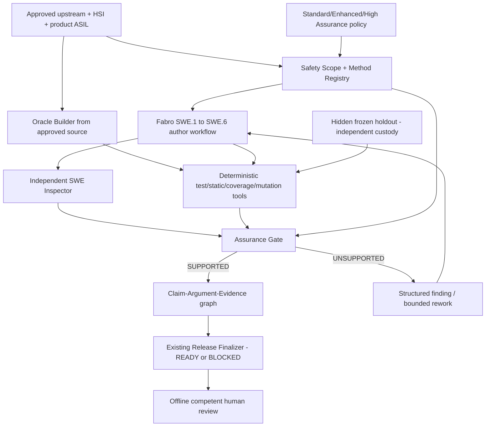

# Feature 006 — Assurance Architecture and Trust Boundaries

**Trust boundaries:**

1. **Product author** runs existing Fabro role and MCP least-privilege grants. The author never has write access to the independent oracle, verification expected results or holdout.
2. **Independent reviewer** uses a different role/session. A different LLM call alone is *not* independence of the verification oracle; correlated sources/skills or tests may invalidate claimed independence.
3. **Oracle authority** takes approved source requirements, HSI, register manual, errata and frozen approved examples; it does NOT derive expected values from the generated C.
4. **Verifier authority** is deterministic or appropriately controlled independent technical review, with OS/container identity separation where feasible. Store raw execution evidence off-context; logs are not prompts.
5. **Assurance gate** consumes signed/hash-linked method selection, oracle provenance, actual executed evidence and independent inspection record; no model or metrics calculation can waive hard failure.
6. **Normative authority** resides in the approved, access-controlled method-catalog review. Working index entries are informational until ratified by a competent safety reviewer and a controlled edition.
7. **Release authority** remains the existing finalizer and offline human. The assurance case does NOT confer certification.

## Integration, not duplication

- Extend `factory/python/forge_factory/inspection/{engine,gate,reverify}.py` for phase policy calls, reusing the current six-stage workflow builder and its frozen hash checks.
- Add `factory/python/forge_factory/assurance/` *only* for method selection, independent oracle contracts, claim graph and interpretation beyond current inspection; do not rebuild event ledger/supervisor/repair/conductor.
- Reuse `factory/python/forge_factory/mcp/servers/{analysis,tests,sim,evidence}.py` for real tool operations with sandbox restrictions. New agent roles get `.fabro/skills/<role>/SKILL.md` and scoped grants; favor non-LLM tool services over new roles.
- Extend `factory/python/forge_factory/release/finalize.py` with explicit assurance inventory entries without changing READY/BLOCKED semantics.
- Extend existing Dashboard Reliability section in place; no second dashboard/data store.

## Release failure semantics

| Condition | Outcome |
|---|---|
| Unsupported method catalog or normative scope | NORMATIVE_UNVERIFIED / no ISO compliance claim; safety scope may BLOCK depending on required evidence |
| Tool missing, no equivalent approved verification | BLOCKED / TOOL_NOT_AVAILABLE |
| Inspector PASS but deterministic execution FAIL | BLOCKED / ASSURANCE_GATE_FAILED |
| Oracle shares implementation-only origin | BLOCKED / ORACLE_NOT_INDEPENDENT |
| Renode passed, target HIL required | BLOCKED / HIL_EVIDENCE_MISSING |
| QM explicit inapplicability supported | N/A with rationale, not fictitious ASIL compliance |
| Analysis says eligible but human safety review absent | READY_FOR_OFFLINE_REVIEW at most, NEVER ASIL_APPROVED |

All decisions append and preserve earlier failed attempts and original first-pass inspector verdicts.
